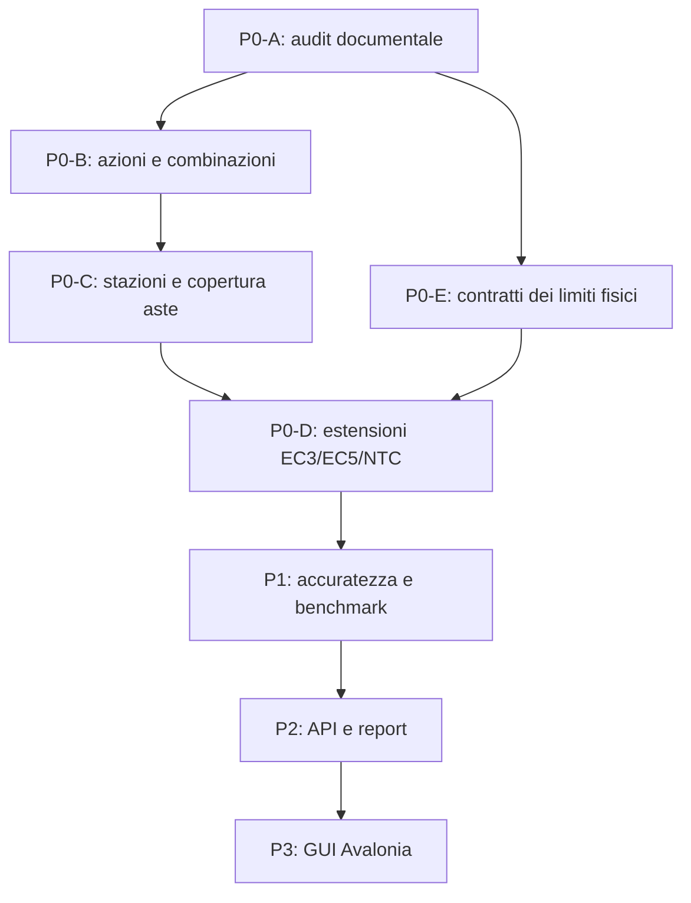

# P0-A — Priorità tecniche e criteri di accettazione P0-B…P0-E

> **Nota storica P0-F0:** backlog originario P0-A, conservato come fonte del ragionamento iniziale. Sono superate le istruzioni che prevedevano nuovi script Python o confronti Python/C#; per i prossimi lavori valgono soltanto i nuovi strumenti **C#/.NET** previsti da [roadmap](roadmap.md) e [regole di sviluppo](ENGINEERING_AND_VALIDATION_RULES.md).

**25 ottobre 2026.** Backlog dedotto da [audit](P0_A_AUDIT_TECNICO.md) e [matrice](P0_A_MATRICE_COPERTURA.md). Non autorizza ancora nuove formule o attestazioni normative. Tutti i ticket richiedono test positivi **e negativi**, golden indipendenti e mantenimento degli esiti G7.

## Principi architetturali per tutti i ticket

1. `Core` conserva geometria, casi e carichi; `Analysis` restituisce effetti e diagnosi **senza dipendere dalle norme**. Nessuna nuova dipendenza del FEM da `Verification.*`.
2. Un modulo dedicato alle combinazioni, eventualmente `StructuralSolver2D.Combinations`, dipende da `Core` e definisce **esplicitamente norma, edizione, configurazione nazionale, categoria/identità di azione**; non inietta formule nei solutori. I validatori devono distinguere **modello lineare risolvibile** e **insieme di combinazioni normative completo**.
3. `Verification.Integration` conserva scenario, stazione, lato e tutti gli effetti concomitanti; `Verification.Steel/Timber` restano moduli separati per norma/versione. La copertura di un'intera membratura richiede un **piano obblighi** e un esito distinto da quello della singola regola.
4. `Unsupported` o `MissingData` non possono diventare `Passed` per omissione, per incongruenza di norma o tramite un'esclusione priva di evidenza. `Failed` credibile prevale sui gap. Nessuna prova di conformità globale prodotta dal FEM 2D.
5. **No GUI** durante P0, P1 o P2. La GUI C#/Avalonia (P3) consuma API/report consolidati.

## Sequenza raccomandata

**P0-B specifica + implementazione**, quindi **P0-C**, con **contratti di evidenza P0-E definiti già durante B/C** e relativa applicazione completa prima di **P0-D**. P0-D si attiva per sottofamiglie con formule e condizioni fisiche che il flusso B/C/E sa dichiarare; non serve attendere un solver 3D o la risoluzione di tutte le lacune per adottare un `Unsupported` esplicito.

Il ramo E parte con il contratto di **evidenza esterna** durante B/C, senza creare un FEM 3D. Qualunque algoritmo nuovo per contatto/tension-only resta futuro, opt-in e separato.

## P0-B — Azioni e combinazioni SLU/SLE, prima priorità (C)

| Ticket e gap | Modifica proposta | Test di accettazione indipendente / controprova |
|---|---|---|
| **B01 — inventario e tipizzazione** (`F13–F15`) | Identità univoca dell'azione, natura G1/G2/Q/accidentale ove applicabile, categoria, provenienza, durata per legno, segno/direzione, gruppo di esclusione, base caratteristiche. Distinguere gli schemi NTC 2018 dagli schemi EC3/EC5; niente norma implicita dal nome della combinazione. | Caso G, Q1, Q2 con etichette ingannevoli; editor JSON invalido deve dare diagnosi. Golden indipendente di categorie e fattori prima della moltiplicazione. |
| **B02 — generatori versionati e condizioni di favore** (`F15`, `V13`, `V17`) | Generatore/validatore per **insiemi dichiarati** SLU fondamentale STR e SLE rara/frequente/quasi permanente NTC 2018, con γ/ψ versionati, azione guida diversa, accompagnatrici, presenza/assenza, gruppi mutuamente esclusivi, carichi firmati e verifica fattori favorevoli/sfavorevoli rispetto agli effetti (non al solo segno del carico). Iniziare da schemi non sismici delimitati. | Derivazione separata tabellare di almeno G1+G2+Qres+Qcorr+neve+vento±+sollevamento; combinazione guida neve vs vento, carichi opposti e soli permanenti. Perturbare fattore o omettere una variante: validator `Incomplete/Invalid`, non `Passed`. |
| **B03 — fattore zero e identità** (`F14`) | Decidere e documentare: **termine esplicito 0** oppure **azione esclusa nel manifesto** distinta dai termini non nulli FEM. Uniformare validatore, serializer, selettori G1/G5 e fingerprint costruito dai dati veri del modello. Non togliere arbitrariamente E07 dai test: versionare la nuova regola e la migrazione. | Prima: E07 negativo ancora vero. Dopo scelta: test zero/assente/nullo/negativo, hash coerenti o errore chiaro; `kmod` ignora solo contributi realmente nulli. |
| **B04 — audit completezza e provenienza** (`V13`, `X05`) | Conservare per risultato `CombinationId`, `CodeEdition`, `LoadCaseId`, `ActionId`, fattori e decisioni di alternativa, fingerprint reale e originaria provenienza. Generatore, validator e audit differenziati. Nessun pass sulla sola stringa `ULS_*`. | Alterare un fattore **nel FEM** senza aggiornare manifesto G1 deve far fallire il match. Rilevare combinazioni mancanti nei quattro G8B senza modificarne gli originali. |

**Gate B:** prove pure del generatore, round-trip JSON, confronto manuale tabelle γ/ψ **con fonti normative primarie fissate a edizione**, suite Core/Analysis/G1–G7 e regressioni CLI. La creazione di combinazioni per **sisma**, fuoco, accidentali complesse non va dichiarata se non specificata/testata.

## P0-C — Stazioni critiche, concomitanze e copertura aste (C)

| Ticket e gap | Modifica proposta | Test di accettazione indipendente / controprova |
|---|---|---|
| **C01 — dati di stazione e scenari** (`F16–F18`, `V01–V02`) | Riutilizzare M78/M87-C preservando tutti i `N,V,M`, `TargetKind`, stazione metrica **e lato**, non solo le coordinate degli estremi. Conservare i risultati per ogni combinazione richiesta e ogni segmento di sezione/ritegno. | Carico puntuale con due lati; due combinazioni con `Nmax` e `Mmax` separati: nessuna richiesta normativamente valida può contenerli insieme. |
| **C02 — criterio di massimo utilizzo** (`V02`) | Per ogni **regola idonea**, esaminare intervalli continui, potenziali estremi della funzione `η(N,V,M)` e discontinuità. Se una regola non consente un massimo dimostrabile, dichiarare `SCREENING_INCOMPLETE` e chiedere campionamento aggiuntivo/giudizio esterno. La sola griglia M87-C non diventa esaustiva. | Costruire combinazione analitica `η(x)` con massimo interno **non coincidente** con massimi individuali N/V/M; una griglia grossolana non può restituire `MemberPassed`. |
| **C03 — completezza degli obblighi** (`V03`, `V18–V19`) | Nuovo report `MemberCheckCoverage` separato dal `DesignCheckReport`; deve includere inventario obblighi, tutte le combinazioni e stazioni, regole pertinenti, esclusioni fisiche, dati esterni e diagnosi. `OverallStatus.Passed` rinominato/mostrato come **pass limitato alle regole richieste** senza breaking change non pianificato. | Una singola regola `Passed` con altra applicabile omessa → `MemberCheckCoverage.Incomplete`; un `Failed` non cancellato da una lacuna; `NotApplicable` richiede motivazione fisica. |
| **C04 — diagrammi vs formule** (`F16`, `F19`, `V21`) | Report con due campi espliciti: estremi **esatti** del FEM e campioni **grafici**, distinguendo freccia interpolata dalla verifica normativa; indicare se è stata fatta convergenza/refinement. | q triangolare/punto interno con picco fra 21 campioni; stampa non indica il massimo campionato come esatto. Test CLI/report. |
| **C05 — Truss e interfaccia** (`V01`, `F02`) | Non forzare `Truss2D` nel bridge Frame. Eventuale `AxialTrussVerificationBridge` separato, con N firmato e stazioni uniformi; rifiutare richieste di flessione inesistente. | Diagonale G8B N+ e N− dai medesimi nodi; nessun risultato di truss spacciato per Frame2D. |

**Gate C:** test sintetici con estremi di **utilizzo**, confronti analitici lungo le aste, casi G7 invariati, report di copertura che restano incompleti quando non è provata l'esaustività. Nessun “asta verificata” da M79 preso isolatamente.

## P0-E — Applicabilità fisica, stabilità, nodi e casi G8B (C/A)

| Ticket e gap | Modifica proposta | Test di accettazione indipendente / controprova |
|---|---|---|
| **E01 — registri di evidenza esterna** (`X03–X04`, `V07–V08`, `V16`) | Schema tipizzato per vincoli laterali/longitudinali, lunghezze d'instabilità per asse, LTB/Mcr, nodi, eccentricità, piastre, fondazioni, diaframmi, certificati. `not relevant` solo con documentazione fisica; `not implemented` resta gap. | Eliminare la prova di un ritegno e ottenere `MissingData`/`Incomplete`; prove di origine, id/member e validità periodo/carico. |
| **E02 — supporti e controventi** (`X01–X02`) | Contratto che distingue **supporto bilatero ideale** da possibile appoggio monolatero, `Truss2D` bilatero da tirante/tension-only. Allertare sulle reazioni negative e compressioni dei controventi; non applicare algoritmo tension-only senza nuova milestone numerica. | B13 `R_A=-5/3 kN`: contrassegnare domanda di ancoraggio. G8B vento±: estrarre N di ognuna delle quattro diagonali con segno; nessuna capacità tension-only dichiarata. |
| **E03 — G8B confronto C# e Python** (`X05–X07`) | Test/harness opzionale che genera i 16 scenari C# (non soltanto report) e confronta numericamente **nodo per nodo**, reazioni per supporto e risultanti con il JSON Python. Ampliare il riferimento Python con **sollecitazioni di estremità e N/V/M in stazioni definite** derivati indipendentemente, prima di promuoverlo. Non riscrivere il golden per adeguarlo al C#. | 4×4 scenari, mismatch evidenziato con id/unità, tolleranze relative+assolute giustificate, 16 report e 2 viewer; test perturbazione forza/release si deve fermare. Log Windows richiesto. |
| **E04 — M82/dinamica e limiti del FEM** (`F20`) | Etichette `experimental/scope-limited` e rifiuti per casi non supportati; valutare Timoshenko, sovrapposizione di effetti geometrici, contatto e tensili solo in P1 separato. | Applicazione di carico distribuito/release a M82 deve fallire; nessuna promessa di 3D, normativa sismica, instabilità tension-only. |

**Gate E:** evidenze fisiche incomplete non devono trasformarsi in ammissibilità. G8B resta *modello di prova* anche se tutte le uscite elastiche coincidono. Non richiede di implementare un solver di contatto dentro P0-E: il primo deliverable è un **contratto conservativo**.

## P0-D — Estensioni normative acciaio e legno (A/C)

| Ticket e gap | Modifica proposta | Test di accettazione indipendente / controprova |
|---|---|---|
| **D01 — revisione della base EC3** (`V04–V09`) | Tabella classe/assi/fori/netti, interazioni N–M–V, buckling pressoflessionale e LTB per segmenti; aggiungere **solo** regole per cui input, edizione EC3 2005+A1:2014 e golden esterni siano verificati. Classi 4, torsione/taglio sottile e collegamenti restano `Unsupported` fino a prova. | Sezione classe 3 in condizioni G8B documentate; classe 4, foro e N+M con instabilità devono rifiutare false verifiche. Benchmark con fonte primaria, tolleranze e controlli limite. |
| **D02 — profilo acciaio NTC 2018 autonomo** (`V10`) | Identità distinta da EC3, coefficienti nazionali e clausole NTC/Circolare; nessun riuso automatico di un `Passed` EC3 a parità di materiale. | Profilo EC3 richiesto su NTC → `Unsupported`; golden italiano indipendente per una prima regola stretta. |
| **D03 — EC5: oltre M92-A/B** (`V11–V12`) | Pianificare interazioni, stabilità, SLE e condizioni d'impiego EC5 in **modulo EC5 versionato**, senza ribattezzare G3–G5 NTC. | Una regola NTC G3 non viene invocata come EC5; confronto indipendente su resistenza e comportamento `Unsupported`. |
| **D04 — NTC legno: casi residui** (`V14–V18`) | Espandere solo con basi fisiche e regolamentari dimostrate: compressione/trazione perpendicolare, intagli/fori, instabilità con N+M, vibrazioni/SLE, collegamenti come responsabilità esterna se non implementati. | Sezione con intaglio e carico combinato non deve superare per omissione; casi analitici indipendenti e verifica fattori G1. |
| **D05 — audit e cataloghi** (`V19–V20`) | Tipizzare esclusioni EC3 come G6, separare proprietà indicativa/certificata, confermare sezioni OPPO e G8B con dati attendibili di fornitura. Non confondere area/inertia per il FEM con tutte le proprietà necessarie al dimensionamento. | Test esclusione `not implemented` produce `Incomplete`; dati sezione modificati/senza fonte vengono rifiutati o marcati non certificati. |

**Gate D:** revisione delle clausole **su testi normativi primari** fissati alle edizioni dichiarate; schede con precondizioni, assi, unità, classe, provenienza di ogni coefficiente, calcolo indipendente e test `Passed`/`Failed`/`MissingData`/`NotApplicable`/`Unsupported`. Il libro Bernuzzi/Ballio–Mazzolani resta ausilio didattico, non fonte legale primaria.

## Definition of Done comune e test da NON perdere

- Sono immutati i golden G7 (`benchmarks/G7_INDEPENDENT_GOLDEN.json`), i benchmark B13/B14 e i test G1–G7. Per cambiare un valore occorre dimostrazione indipendente, versione del golden e motivo, mai una correzione opportunistica.
- Build .NET 8 Release, `warnaserror`, xUnit moduli Core/Analysis/Catalogs/Verification/Reporting/CLI, smoke test JSON degli esempi e QA viewer, con **log Windows**. L'esito viene riportato in `CHANGELOG.md` e `HANDOFF_NUOVA_CHAT.md` solo **dopo** esecuzione confermata.
- Dataset `benchmarks/` separati da `examples/`; FIX2 conservato per la migrazione di estrazioni sovrapposte; integrità SHA256 e controllo **file extra** del pacchetto.
- Ogni nuova funzione produce esito semantico separato da accettabilità normativa globale, documentazione del limite e benchmark piccolo con calcolo manuale riproducibile.
- **P0-A chiude la fase documentale.** Non autorizza oggi un `G8B GATE PASSED`, un `P0-B PASSED` o la progettazione della casetta.
